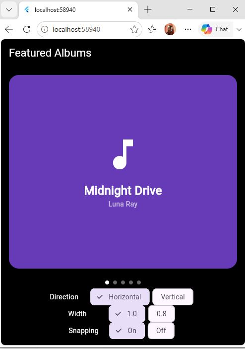

# Album Swiper (PageView Demo)

## What is PageView?

PageView is a Flutter widget that enables users to switch between pages through horizontal or vertical swipes.

## About my demo

In this demo, I have built an album swiper that enables users to browse five fictional music albums. Every album has a distinct name, artist and color.

To illustrate the impact of scrollDirection, viewportFraction and pageSnapping attributes on this album swiper, I used PageView.builder and added three different controls.

## How to run

1. Ensure you have Flutter SDK and Git installed. You will need VS Code or Android Studio.
2. Clone this repository:

   ```bash
   git clone https://github.com/Umutoni123-aa/album-swiper-pageview.git
   ```

3. Go to the project folder and install the packages:

   ```bash
   cd album-swiper-pageview
   flutter pub get
   ```

4. Run the app:

   ```bash
   flutter run
   ```

   To run it in Chrome instead:

   ```bash
   flutter run -d chrome
   ```
## The 3 attributes

### 1. scrollDirection

- **Default value:** Axis.horizontal
- **What it changes on screen:** This attribute dictates the direction in which users can swipe to switch between albums. Setting it to horizontal means users can only swipe left and right. Setting it to vertical
- **Why a developer would change it:** It depends on how they want users to navigate through the content.
### 2. viewportFraction

- **Default value:** 1.0
- **What it changes on screen:** It controls how much space each album takes up on the screen. At 1.0, an album fills the available space. At 0.8, part of the next album becomes visible.
- **Why a developer would change it:** To give users a preview of the next album and make the interface look more like a carousel.

### 3. pageSnapping

- **Default value:** true
- **What it changes on screen:** When enabled, the page settles into position after scrolling. When disabled, users can scroll more freely without the same page-by-page snapping.
- **Why a developer would change it:** To decide whether users should view one complete page at a time or have more freedom when scrolling.

## Screenshot



## Credits

I used Flutter documentation as a reference while building the demo.